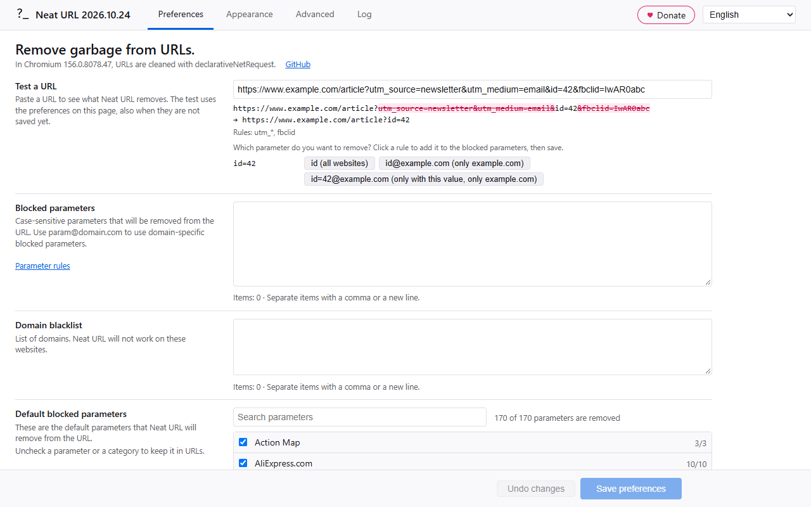

# Neat URL

Neat URL removes tracking parameters from the URLs you open, like Google Analytics' `utm_source`, Facebook's `fbclid` and Google Ads' `gclid`. The page loads without them, so the link you bookmark, copy or share is clean too.

[Download for Firefox][] (Firefox 140 or newer), [download for Chrome][] (Chrome 121 or newer) or [download for Edge][] (Edge 121 or newer).

[Download for Firefox]: https://addons.mozilla.org/en-US/firefox/addon/neat-url/
[Download for Chrome]: https://chrome.google.com/webstore/detail/neat-url/jchobbjgibcahbheicfocecmhocglkco
[Download for Edge]: https://microsoftedge.microsoft.com/addons/detail/cpdnbjinpdgpjboopnojaldcemijgnao

## Example

Before:
* https://www.phoronix.com/scan.php?page=news_item&px=Ioquake3-Auto-Updater&utm_source=feedburner&utm_medium=feed&utm_campaign=Feed%3A+Phoronix+(Phoronix)

After:
* https://www.phoronix.com/scan.php?page=news_item&px=Ioquake3-Auto-Updater

## How to use it

Neat URL works right after you install it: 170 well-known tracking parameters are removed by default. You only need the options if a website doesn't work, or if you want to remove more.

* **Click the toolbar button** to open the options page with the URL of the current tab in Test a URL. You see which parameters are removed, and you can add a rule for the ones that are left.
* **Right-click the toolbar button** to disable Neat URL (until the browser restarts), or to open the Log.
* The **counter** on the toolbar button shows how many URLs were cleaned in the current tab.

Almost every feature works in both browsers; see [Browser support](docs/browser-support.md) for the differences.

## Privacy

Neat URL doesn't collect or send any data. It needs access to all websites to clean their URLs. The log of cleaned URLs is kept in memory only and is empty after a browser restart.

## Options

The options page has the tabs Preferences, Appearance, Advanced and Log. Changes are kept until you click Save (or press Ctrl+S); the bar at the bottom shows when there are unsaved changes. The language of the options page can be chosen at the top right (the language of the browser by default).

* **Test a URL**: paste a URL to see which parameters Neat URL removes and which rules removed them. The test uses the preferences on the page, also before you save them. For every parameter that is left, it suggests a rule (`name` for all websites, `name@domain` for that domain only, `name=value@domain` for that domain only when the parameter has that value); a click adds the rule to the blocked parameters.
* **Blocked parameters**: your own rules, see [Parameter rules](#parameter-rules).
* **Remove text fragments** (off by default): remove the text that a link highlights on the page, `#:~:text=...`, which search engines and "Copy link to highlight" add. https://example.com/page#intro:~:text=some%20words becomes https://example.com/page#intro: the anchor stays, and so do other directives after `:~:`. The page then no longer scrolls to that text.
* **Websites**: where Neat URL changes URLs. Choose "All websites, except these domains" (the default, the domain blacklist of earlier versions) or "Only these domains" (a whitelist; when the list is empty, Neat URL works on all websites). A domain also covers its subdomains, and wildcards work here too: `archive.*` for archive.org, archive.ph and so on, `*.archive.*` also for web.archive.org. Each choice keeps its own list, so switching doesn't lose your domains; only the list of the chosen option is used.
* **Default blocked parameters**: a list per category with a search field. Uncheck a parameter or a whole category to keep it in URLs. ([The same list as a file](data/default-params-by-category.json).) Turn off **Use the default blocked parameters** to remove only your own blocked parameters, also none that a new version adds; your choices in the list are kept.
* Below every list, the options page shows the number of items and warns about invalid rules, duplicates and parameters that are already a default.

Appearance:

* **Icon animation**, **icon theme** and the **counter** on the toolbar button, with its color.

Advanced:

* **Change links in page** (off by default): also clean the links in a page, so a copied link is clean too.
* **Keep signed URLs** (on by default): URLs with a signature parameter (`sig`, `hmac` or a name that ends with `signature`, like `X-Amz-Signature`) are not changed, because the server rejects them after any change.
* **Clean URLs inside parameters** (off by default): also clean a URL that is the value of a parameter, for example `https://example.com/?url=https%3A%2F%2Fexample.org%2F%3Futm_source%3Dx` becomes `https://example.com/?url=https%3A%2F%2Fexample.org%2F`. Some sites check that such a link was not changed (for example login redirects), so this is off by default.
* **URL request types**: the kinds of requests that are cleaned, `main_frame` (the page in a tab) by default.
* **Sync preferences**: use the same preferences on every device where this option is on. They are stored with the account of the browser (Firefox Sync, or a Google or Microsoft account). Off by default.
* **Import and export**: save all preferences to a file, or load them from a file.
* **Restore defaults**: puts all preferences back to their default values (after Save).

Log:

* The last cleaned URLs, with the removed parameters struck through and the rules that removed them. **Save log for a bug report** stores the log in a file with the technical details (version, browser, engine, platform and your preferences).

## Parameter rules

A parameter is a part of the URL after the `?`, separated by `&`: in `https://example.com/?utm_source=mail&id=5` the parameters are `utm_source` and `id`. In the options you only write the name, without `?` or `&`, so `?ved` becomes `ved`. There are a few exceptions to this rule (see below).

Most people never need to write a rule themselves: Test a URL suggests one for every parameter that is left.

Parameters can be global (for every domain):

    utm_source

Parameters can contain @ signs (domain-specific):

    nb@tweakers.net

Parameters can contain @ signs with a wildcard so every subdomain will match too (root wildcard domain):

    param@*.wired.com

Parameters can contain @ signs with a wildcard at the end of a domain name (matches every domain name which begins with "google" and ends in an unknown suffix, called suffix wildcard domain):

    param@google.*

Mixing a root wildcard domain with a suffix wildcard domain in the same parameter is also possible:

    param@*.google.*

Parameters can contain a wildcard at the end or before the domain sign:

    utm_*
    utm_*@omgubuntu.co.uk
    *@omgubuntu.co.uk

Parameters can also apply globally (first rule), except for a (wildcard) domain (second rule):

	ref
	!ref@amazon.co.uk

The excluded domain always takes precedence. Should you include "ref" and "!ref", "!ref" will apply. This also works against wildcards: `sc_*, !sc_itemid` removes every `sc_` parameter except `sc_itemid`.

Parameters can be removed only when they have a certain value:

    ref=share@amazon.com (removes ?ref=share, but keeps ?ref=other)

All parameters with a name of a certain length can be removed (for example the random names 1Password adds):

    KEY{11}@example.com

The list can be split into groups with a header line that ends with a colon:

    Tweakers:
    nb@tweakers.net, u@tweakers.net

Or with a label at the start of a line (a colon followed by a space):

    Tweakers: nb@tweakers.net, u@tweakers.net

Other valid parameters - ending parameters (exceptions to the ? rule):

|||
| --- | --- |
| `$/ref@amazon.*` | remove everything after `/ref` on Amazon domains - this will only apply when there are no query parameters left after removing the filtered query parameters.  Exception: Amazon product pages are cleaned as if the rule had two dollar signs |
| `$$/ref@amazon.*` | remove everything after `/ref` on Amazon domains - this will always apply, even when there are other query parameters after removing the filtered query parameters - this option is available because the user should be in control but beware that double dollar signs are dangerous, it might break the URL |

Other valid parameters - hash parameters (exceptions to the ? rule):

|||
| --- | --- |
| `#xtor=RSS-8` | remove this parameter - be sure to include its value as well when you are using anchor tags |
| `#xtor=RSS-8@futura-sciences.com` | for example this URL https://www.futura-sciences.com/magazines/espace/infos/actu/d/astronautique-curiosity-franchi-succes-dune-dingo-gap-52289/#xtor=RSS-8 |
| `#?pk_campaign` | normal parameters that come after a hash sign, for example this URL https://vivaldi.com/blog/teamblog/vivaldi-1-13-adds-window-panel/#pk_campaign=newsletter&pk_kwd=community gets changed to https://vivaldi.com/blog/teamblog/vivaldi-1-13-adds-window-panel/#pk_kwd=community |
| `#?pk_campaign@vivaldi.com` | same as above, but domain-matched instead of global |

Invalid parameters:

|||
| --- | --- |
| `\|ved` | this is some random string - not supported, it will not work |
| `/ref@amazon.*$` | dollar sign should be at the beginning |
| `ref@*` | domain cannot be a wildcard, use ref instead to apply globally |

## Help, it does not work!
* A website doesn't work any more? Uncheck the parameter in the default blocked parameters (for a default parameter), add an exclusion like `!param@example.com`, or add the domain to Websites (All websites, except these domains).
* Click the toolbar button on the page: the options page opens with that URL in Test a URL, so you see which parameters are removed and get suggestions for rules.
* Open the Log tab of the options page (right-click the toolbar button → Log) to see which URLs were changed, which parameters were removed and which rules removed them.
* Have you checked that the syntax of your rules is valid? The options page warns about invalid rules below the list.
* Firefox: check that Neat URL has access to all websites (Add-ons → Neat URL → Permissions). The options page shows a button when access is missing.
* Extensions (like Neat URL) aren't allowed to change requests to several Mozilla domains. This is a security feature of Firefox. On addons.mozilla.org and support.mozilla.org, Neat URL loads the clean URL in the tab after the page started loading. For the other domains, you need to edit extensions.webextensions.restrictedDomains in about:config.
* A hash that changes without loading a page (for example a link to #section on the same page) can't be cleaned. See [Browser support](docs/browser-support.md).
* Still a problem? [Open an issue on GitHub](https://github.com/Smile4ever/Neat-URL/issues/new) and attach the file from **Save log for a bug report** on the Log tab.

## Documentation

* [Browser support](docs/browser-support.md): which features work in Firefox and Chrome
* [Architecture](docs/architecture.md): how Neat URL cleans URLs in each browser
* [Development](docs/development.md): build, test and release
* [Recommended parameters](docs/recommended-parameters.md): notes about parameters that are, or could become, a default
* [Store listing](docs/store-listing.md): the texts and screenshots for addons.mozilla.org and the Chrome Web Store

## History
Neat URL is based on [Lean URL](https://github.com/xmikro/lean-url/).

Neat URL contains a few improvements:
* set your own URL parameters on the options page (to reach feature parity with Pure URL)
* works in Firefox and Chrome (Manifest V3)
* a nice animation and counter in the toolbar (can be changed or disabled)
* domain-specific blocked parameters (to reach feature parity with Pure URL)
* wildcard domain-specific blocked parameters
* wildcard at the end of blocked parameters (general or domain-specific)
* absolute wildcard parameter (domain-specific)
* expanded default blocked parameter offering
* Test a URL with suggested rules, and a log of the cleaned URLs
